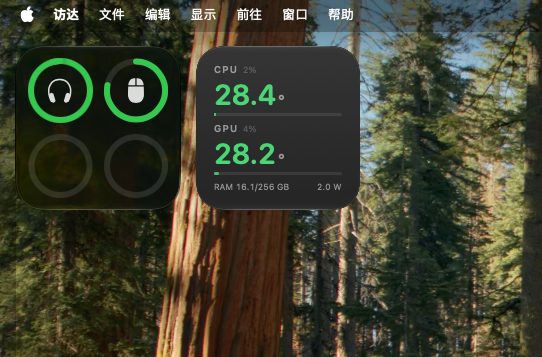

<div align="center">



# M5Vitals · WidgetKit edition

**CPU / GPU temperature as a real macOS desktop widget** — it lives in the widget gallery, snaps into the system grid, and sits next to Weather and Calendar.

[中文](#中文) · [English](#english) · [日本語](#日本語) · [轻量版 / window edition ↗](https://github.com/qinchuqiaox-creator/M5Vitals)

</div>

---

## 两个版本，自己挑

这个仓库是**原生版**。同一个数据源、同一个设计，还有另一个**轻量版**，两者互不依赖：

| | **原生版（本仓库）** | [**轻量版 ↗**](https://github.com/qinchuqiaox-creator/M5Vitals) |
|---|---|---|
| 形态 | 系统 WidgetKit 小组件（`.appex`） | 无边框窗口，钉在桌面层 |
| 进「编辑小组件」库 | ✅ 能，和天气/日历并排 | ❌ 不能 |
| 拖动时系统吸附方框 | ✅ 有 | ❌ 自由拖动，只记位置 |
| 尺寸档位 | 小 / 中 | 固定 200×136（可改源码） |
| 刷新节奏 | **1 / 5 / 15 / 30 分钟可选**，最终由系统预算决定 | **2 秒**，真实时 |
| 菜单栏图标 | ❌ 无 | ✅ 🌡 显示 CPU/GPU 温度 |
| 多桌面 / 换显示器 | 跟随系统自动重排 | 自己记坐标 |
| 内存占用 | 42 MB | 80 MB |
| 编译门槛 | **需要完整 Xcode（~16 GB）+ xcodegen** | 只要 Command Line Tools |
| 适合谁 | 想要"和系统小组件一样"的人 | 想要秒级实时数字的人 |

两者都只负责画图 —— 传感器读取全部由 [macmon](https://github.com/vladkens/macmon) 提供。

---

## 中文

### 它是什么

一个**真正的** macOS 桌面小组件：注册进系统的 WidgetKit，出现在「编辑小组件」库里，拖到桌面右上角时会有系统吸附方框，能和天气、日历、设备电量那些并排摆着，换分辨率、切桌面都跟着系统走。

```
CPU  2%            28.4°
────────────────────────
GPU  4%            28.2°
────────────────────────
RAM 16.1/256 GB    2.0 W
```

温度按档位变色：< 68 °C 绿，68–80 琥珀，80–90 橙，90+ 红。

### 实测机型

| | |
|---|---|
| 芯片 | **Apple M5 Ultra**（30 核：10 + 20） |
| 机型 | Mac Studio (Mac17,15)，256 GB |
| 系统 | macOS 27 |
| 状态 | 内存 42 MB（Apple 天气小组件 60 MB、股市 62 MB）；温度与 `macmon` 逐次比对一致 |

### 刷新间隔可以自己设

右键小组件 →「编辑 M5Vitals」→ **Refresh every**，可选 **1 / 5 / 15 / 30 分钟**。

诚实说明：这只是「请求」频率。WidgetKit 的时间线由系统按预算调度，**1 分钟不一定被满足**（过热、低电量、锁屏时会降频）。实测 5 分钟能被稳定满足。

### 数据来源（重要）

传感器读取**不是**本项目实现的，全部来自开源项目 **[macmon](https://github.com/vladkens/macmon)**（MIT，作者 [@vladkens](https://github.com/vladkens)）：通过 SMC + IOReport 读取温度/占用/功耗，**不需要 `sudo`**，在 `127.0.0.1:41414` 暴露 JSON。这个小组件每 N 分钟读一次那个接口。

macmon 帮到你的话，去给它点个 star ⭐

### 安装

```bash
brew install macmon
macmon serve --install --host 127.0.0.1 --port 41414   # 传感器后端

git clone https://github.com/qinchuqiaox-creator/M5Vitals-WidgetKit.git
cd M5Vitals-WidgetKit
./build.sh          # 需要 Xcode + xcodegen：brew install xcodegen
```

装完：桌面右键 →「编辑小组件」→ 搜 **M5Vitals** → 拖到桌面。

### 为什么必须装 Xcode

小组件不是一个程序，而是「宿主 App + 内嵌 `.appex` 扩展 + 沙盒权限 + 系统注册」一整套包，只有 Xcode 的装配线能把它正确拼装、签名、注册进 pluginkit。用 ad-hoc 自签名就能在本机跑通，不需要付费开发者账号。

---

## English

### What it is

A **real** macOS desktop widget: a WidgetKit extension that shows up in the widget gallery, snaps into the system grid with the familiar placeholder box, and sits next to Weather and Calendar. It follows the system when you change resolution or Spaces.

### Tested on

Apple M5 Ultra / Mac Studio (Mac17,15) / macOS 27 — 42 MB resident memory, temperatures cross-checked against `macmon` (Apple's Weather widget uses 60 MB).

### Configurable refresh

Right-click the widget → *Edit M5Vitals* → **Refresh every**: 1 / 5 / 15 / 30 min. This is a *request* — WidgetKit budgets timeline updates, so 1 minute is not guaranteed; 5 minutes has been stable in practice.

### Data source

All sensor reading is delegated to **[macmon](https://github.com/vladkens/macmon)** (MIT, by [@vladkens](https://github.com/vladkens)) — SMC + IOReport, no `sudo`, JSON on `127.0.0.1:41414`. Go star it ⭐

### Install

```bash
brew install macmon && macmon serve --install --host 127.0.0.1 --port 41414
git clone https://github.com/qinchuqiaox-creator/M5Vitals-WidgetKit.git
cd M5Vitals-WidgetKit && ./build.sh    # needs Xcode + brew install xcodegen
```

Then: right-click the desktop → *Edit Widgets* → search **M5Vitals**.

### Licence

MIT.

---

## 日本語

### これは何か

本物の macOS デスクトップウィジェットです。WidgetKit 拡張としてシステムに登録され、ウィジェットギャラリーに現れ、ドラッグすると例の吸着枠が出て、天気やカレンダーと並べて置けます。

### 動作確認

Apple M5 Ultra / Mac Studio (Mac17,15) / macOS 27 — 常駐メモリ 42 MB（Apple の天気ウィジェットは 60 MB）、温度は `macmon` と一致。

### 更新間隔は変更できます

ウィジェットを右クリック →「M5Vitals を編集」→ **Refresh every** で 1 / 5 / 15 / 30 分から選択。ただしこれは「リクエスト」であり、実際の更新はシステムの予算で決まります（1 分が保証されるわけではありません）。

### データ取得元

センサー読み取りは **[macmon](https://github.com/vladkens/macmon)**（MIT、作者 [@vladkens](https://github.com/vladkens)）に委ねています。SMC + IOReport、`sudo` 不要、`127.0.0.1:41414` で JSON を公開。ぜひスターを ⭐

### インストール

```bash
brew install macmon && macmon serve --install --host 127.0.0.1 --port 41414
git clone https://github.com/qinchuqiaox-creator/M5Vitals-WidgetKit.git
cd M5Vitals-WidgetKit && ./build.sh    # Xcode と xcodegen が必要
```

その後：デスクトップを右クリック →「ウィジェットを編集」→ **M5Vitals** を検索。

### ライセンス

MIT。

---

## Credits

- **[macmon](https://github.com/vladkens/macmon)** — the entire sensor layer (SMC / IOReport, no sudo). MIT.
- Xcode project generated by [XcodeGen](https://github.com/yonaskolb/XcodeGen).
- Sibling project: [M5Vitals (window edition)](https://github.com/qinchuqiaox-creator/M5Vitals) — 2-second live card, no Xcode required.
